# osTicket – Post-Install Configuration

## Project Overview

This project documents the post-installation configuration of **osTicket**, an open-source IT help desk ticketing system.

After installing osTicket on a Windows virtual machine in Microsoft Azure, I configured the help desk environment to simulate common IT support operations, including managing departments, teams, agents, user accounts, help topics, and Service Level Agreements (SLAs).

The purpose of this lab was to gain hands-on experience administering a ticketing system and understanding how IT support teams organize, prioritize, and manage support requests.

---

## Environments and Technologies Used

- Microsoft Azure (Virtual Machines)
- Windows 10
- Remote Desktop Protocol (RDP)
- Internet Information Services (IIS)
- osTicket v1.15.8
- Web-based osTicket Admin and Staff Control Panels

## Configuration Objectives

- Access the osTicket Staff and Admin Control Panels
- Review general help desk settings
- Create an administrative role
- Configure departments and support teams
- Review user authentication settings
- Create and manage help desk agents
- Create end-user accounts
- Configure ticket help topics and priorities
- Create Service Level Agreements (SLAs)
- Modify and remove departments

---

## Configuration Steps and Screenshots

### Step 1 – Access the Staff Control Panel

After completing the osTicket installation, I logged into the Staff Control Panel.

The dashboard provides access to support tickets, user accounts, tasks, and the knowledge base.

I verified that osTicket was operational and that the default installation ticket appeared in the ticket queue.

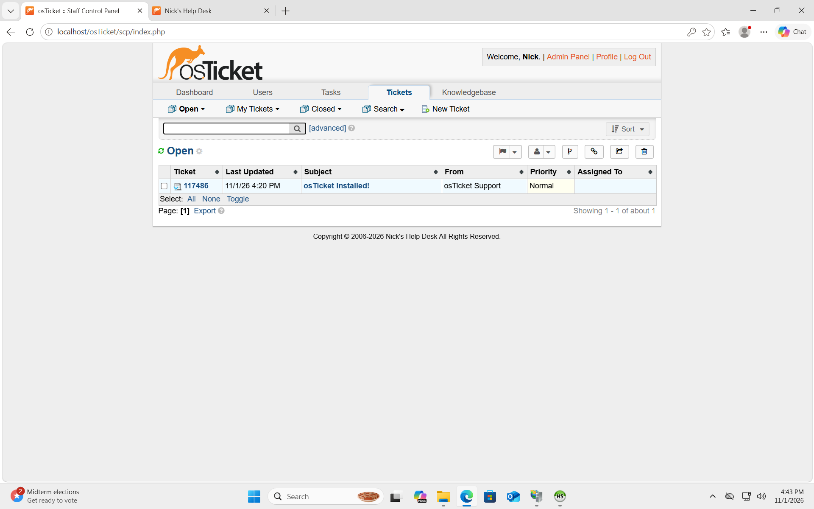

### Step 2 – Verify the Support Center

I opened the customer-facing Support Center to verify that end users could access the help desk.

The Support Center allows users to:

- Submit new support tickets
- Check the status of existing tickets
- Access the help desk portal

This confirmed that the customer-facing interface was accessible.

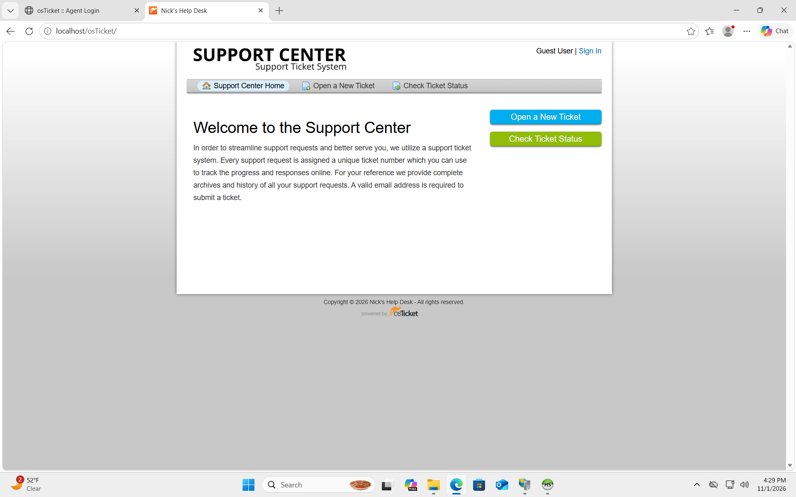

### Step 3 – Review System Settings

I navigated to **Admin Panel → Settings → System** to review the general help desk configuration.

The settings displayed:

- Helpdesk Name: Nick's Help Desk
- Helpdesk Status: Online
- Default Department: Support
- Default Time Zone: America/Los_Angeles

I also reviewed logging, security, and other system preferences.

The page displayed a security warning regarding write access to the `ost-config.php` configuration file. Removing unnecessary write permissions is an important post-installation security measure.

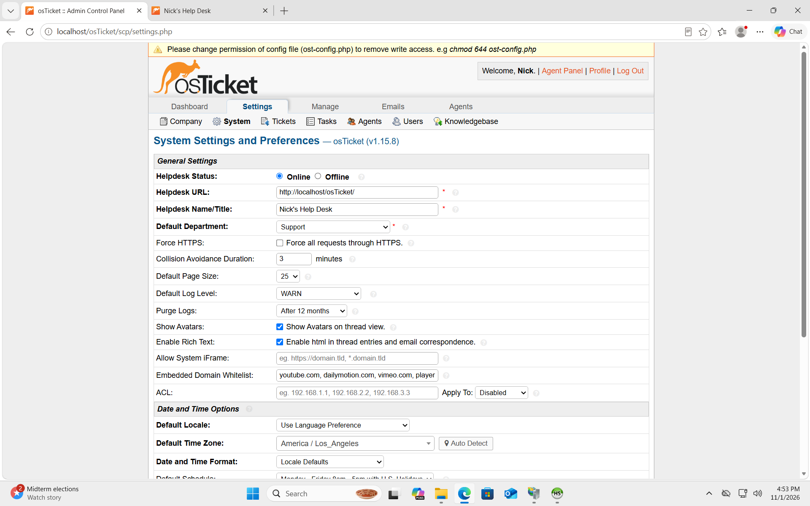

### Step 4 – Create an Administrative Role

I navigated to **Admin Panel → Agents → Roles** to configure administrative permissions.

I created a new role named **Supreme Admin**.

The role appeared alongside the existing access roles:

- All Access
- Expanded Access
- Limited Access
- View Only

Creating roles helps administrators manage permissions and control access to help desk functions.

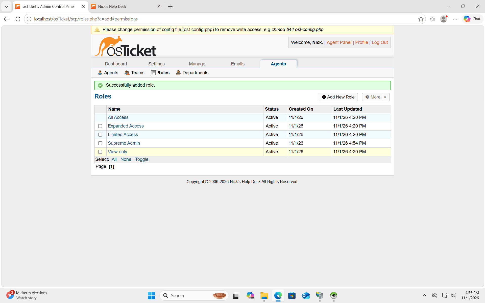

### Step 5 – Configure Departments

I navigated to **Admin Panel → Agents → Departments**.

The department list showed:

- Support
- Maintenance
- SysAdmins

The screenshot confirmed that the **SysAdmins** department was successfully created.

Departments allow help desk administrators to organize tickets and agents according to different areas of IT support.

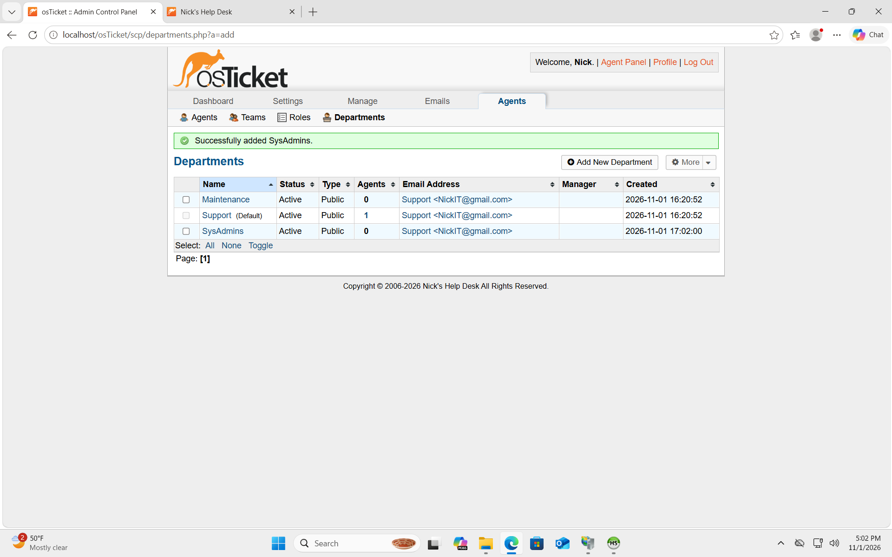

### Step 6 – Configure Support Teams

I navigated to **Admin Panel → Agents → Teams** to review the available teams.

The team list included:

- Level I Support
- Online Banking

The **Online Banking** team was configured and appeared as active.

Teams allow agents from different departments to collaborate on specific support requests.

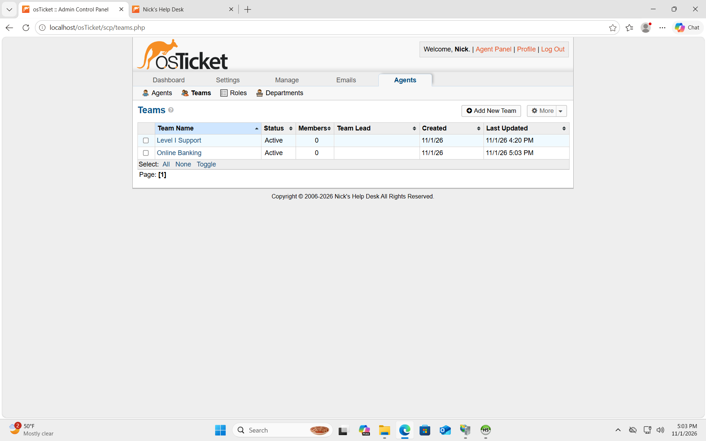

### Step 7 – Review User Authentication Settings

I navigated to **Admin Panel → Settings → Users**.

I reviewed settings related to:

- User registration
- Password policies
- Failed login attempts
- Account lockout duration
- User session timeouts
- Authentication tokens
- Email verification

The screenshot showed a configuration allowing four failed login attempts before a two-minute lockout.

These settings help administrators control user access and authentication behavior.

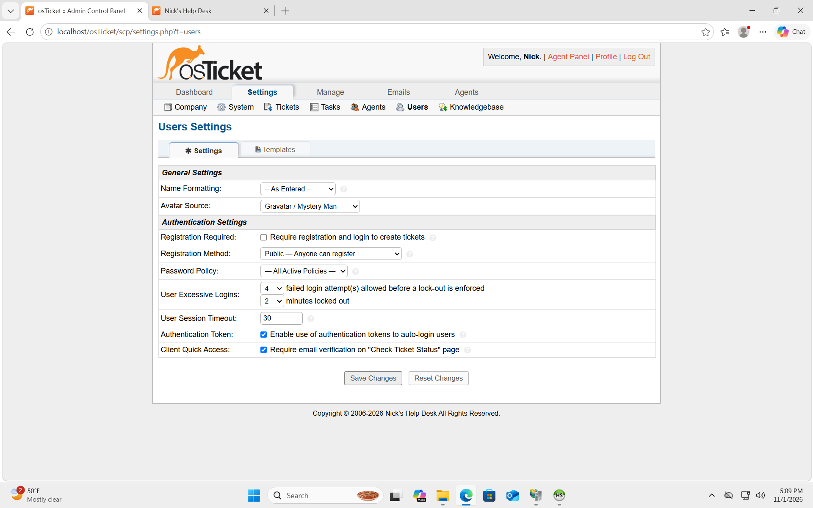

### Step 8 – Configure Help Desk Agents

I navigated to **Admin Panel → Agents → Agents**.

The agent directory displayed three active accounts:

- Jane Doe – SysAdmins
- John Doe – Support
- Nick Rocha – Support

This demonstrated the use of separate staff accounts and department assignments within the ticketing system.

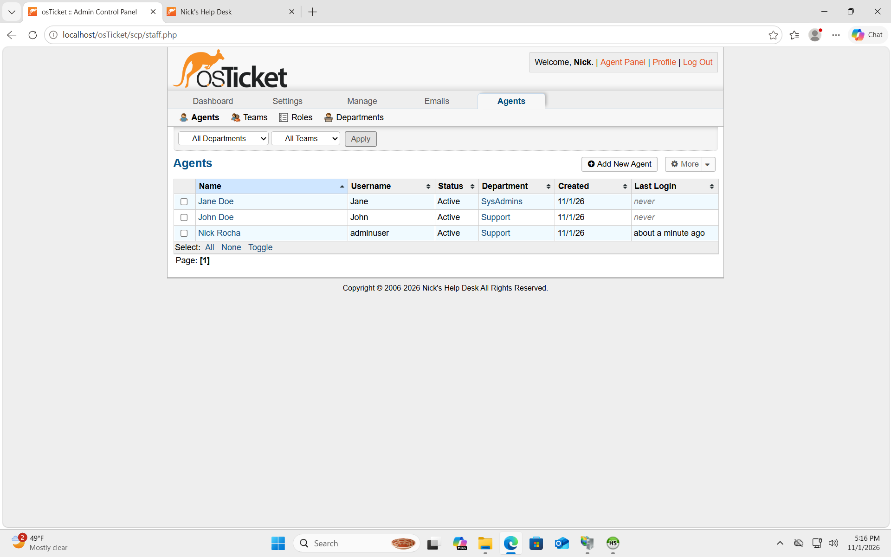

### Step 9 – Create End-User Accounts

I navigated to **Staff Panel → Users → User Directory**.

The directory contained:

- Karen
- Ken
- osTicket Support

Karen and Ken were present as guest users.

Creating end-user accounts allows a help desk to associate support requests with the individuals requesting assistance.

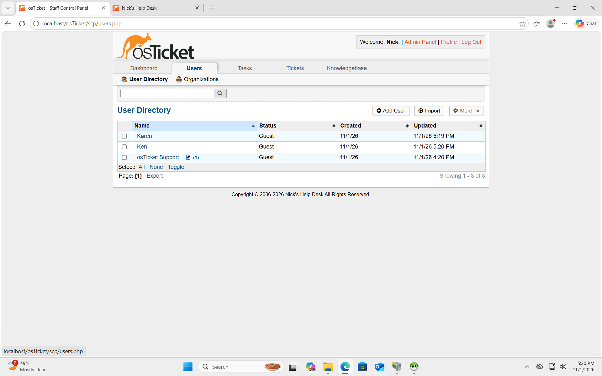

### Step 10 – Configure Service Level Agreements (SLAs)

I navigated to **Admin Panel → Manage → SLA**.

I configured three severity-based SLA plans in addition to the default SLA.

| SLA Plan | Grace Period |
|---|---|
| Sev-A | 1 hour |
| Sev-B | 4 hours |
| Sev-C | 8 hours |
| Default SLA | 18 hours |

These grace periods define the time allowed before a ticket is considered overdue under its assigned SLA.

The screenshot confirmed that the SLA plans were successfully added and active.

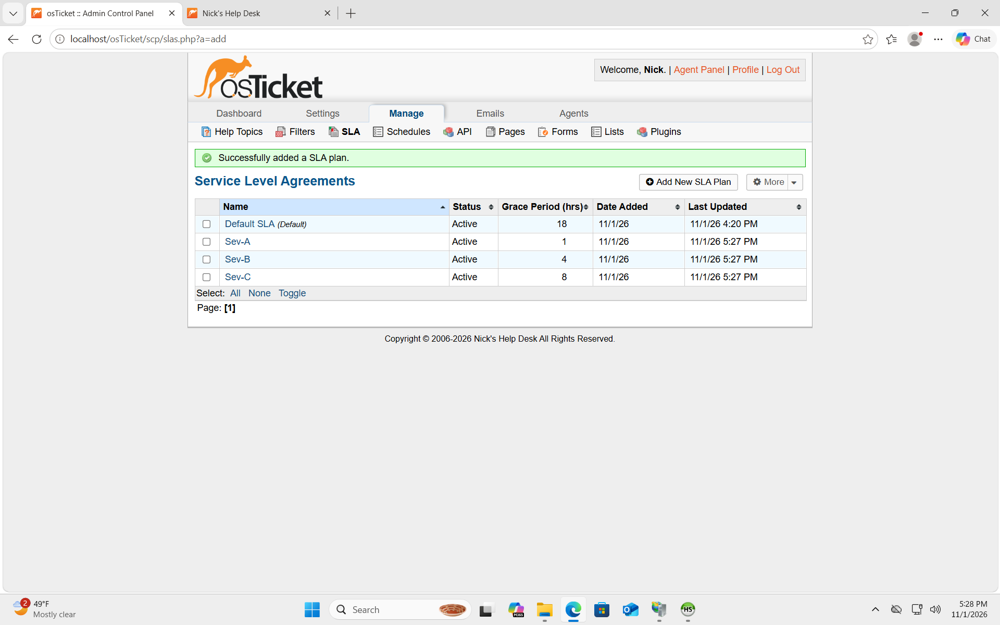

### Step 11 – Configure Help Topics

I navigated to **Admin Panel → Manage → Help Topics**.

I configured and reviewed several help topics, including:

- General Inquiry / Equipment Request
- General Inquiry / Other
- Report a Problem / Access Issue
- Report a Problem / Business Critical Outage
- Report a Problem / Password Reset
- Report a Problem / Personal Computer Issues

The **Access Issue** help topic was assigned high priority.

Help topics help categorize incoming tickets and direct support requests to the appropriate department.

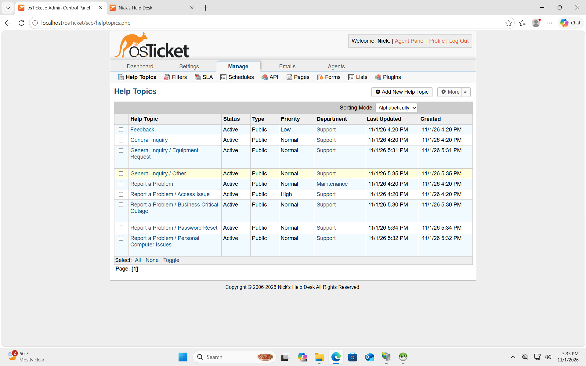

### Step 12 – Update the SysAdmins Department

I navigated to **Admin Panel → Agents → Departments → SysAdmins**.

I reviewed and updated the department configuration, including:

- Department name
- Active status
- Public department type
- SLA settings
- Ticket assignment settings
- Email and autoresponder settings

The screenshot confirmed that the SysAdmins department was successfully updated.

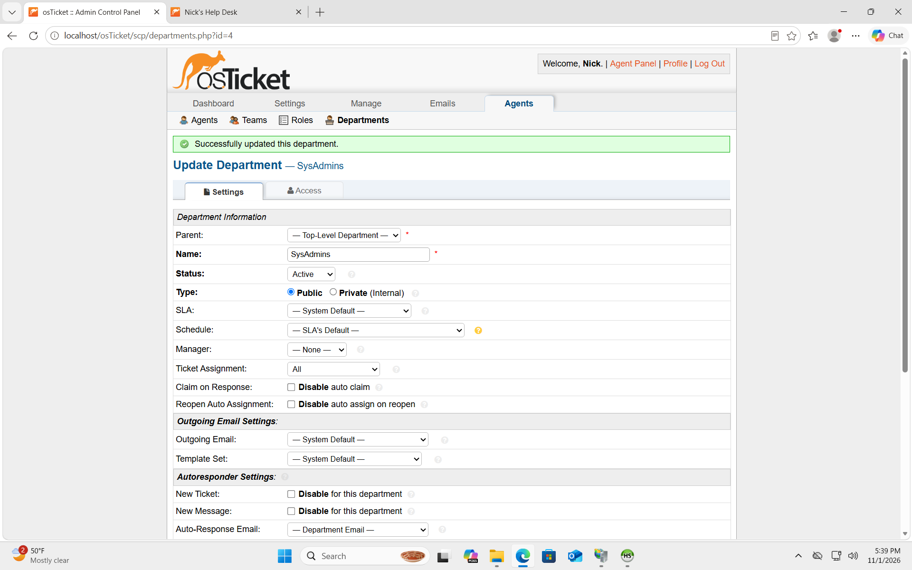

### Step 13 – Manage and Remove a Department

I returned to **Admin Panel → Agents → Departments**.

I removed the Maintenance department.

The system displayed a confirmation message indicating that the selected department had been successfully deleted.

The remaining departments were:

- Support
- SysAdmins

This demonstrated basic administrative maintenance and department management.

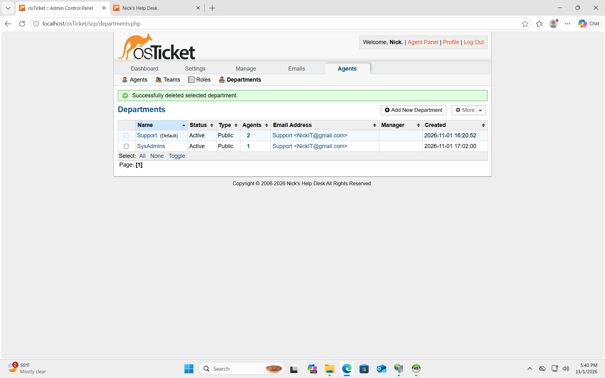

---

## Skills Demonstrated

Through this lab, I gained practical experience with:

- Help desk ticketing system administration
- Role-based access control
- Agent and user account management
- IT department and team organization
- SLA configuration and ticket prioritization
- User authentication settings
- Ticket categorization and help topics
- Administrative system configuration
- Basic help desk security considerations

## Conclusion

I successfully completed the post-installation configuration lab for osTicket.

I practiced configuring the administrative components of a help desk environment, including agents, departments, teams, access roles, user accounts, help topics, and Service Level Agreements.

This project strengthened my understanding of how IT support departments organize incoming requests, manage staff permissions, and establish ticket-handling procedures.

These are practical skills relevant to entry-level **IT Help Desk, IT Support Technician, and Service Desk Analyst** positions.
